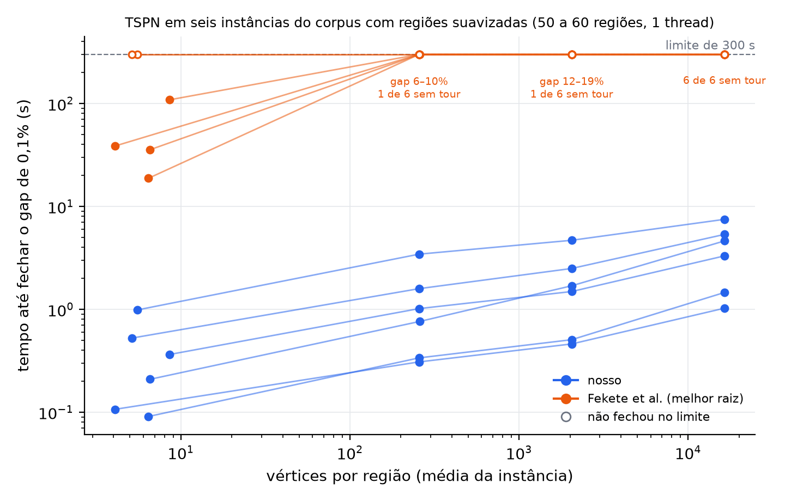

# Escala com o número de vértices por região



Seis instâncias do corpus do Fekete (50 a 60 regiões). Cada região foi trocada
pelo seu fecho convexo somado a um disco de raio igual a 1% da mediana dos
diâmetros, com 256, 2.048 ou 16.384 pontos; à esquerda está o fecho sem disco.
Nosso solver e o do Fekete et al. (código original, melhor das raízes CHR e
LEFP) rodaram com uma thread e limite de 300 s, no Mac. Os marcadores vazios não
fecharam o gap de 0,1% no limite; o texto em laranja diz onde o Fekete parou.

Dados e protocolo:
[`fekete-smoothed-mac-2026-10-21`](../../../benchmarks/results-saved/README.md#fekete-smoothed-mac-2026-10-21).
Para gerar a figura de novo:

```bash
.build/fekete-upstream/venv/bin/python docs/reports/escala-vertices/generate_vertex_scaling_figure.py
```
