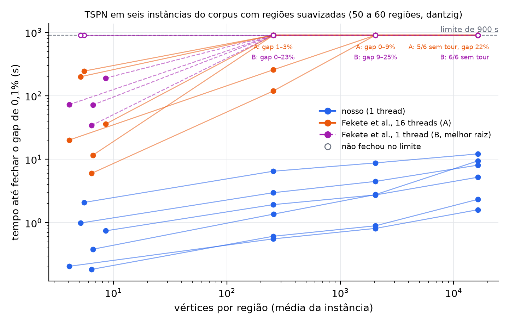

# Escala com o número de vértices por região

Seis instâncias do corpus do Fekete (50 a 60 regiões). Cada região foi trocada
pelo seu fecho convexo somado a um disco de raio igual a 1% da mediana dos
diâmetros, com 256, 2.048 ou 16.384 pontos; à esquerda está o fecho sem disco.
Os marcadores vazios não fecharam o gap de 0,1% no limite. O texto colorido diz
onde o Fekete parou: quantas execuções ficaram sem tour e o gap final das
outras.

## Na máquina de referência (dantzig)



O nosso com uma thread (C) contra o código original do Fekete et al. com 16
threads (A) e com uma thread (B, a melhor das raízes CHR e LEFP), no protocolo
da referência. O Fekete teve até 900 s: 300 s e a extensão. Dados:
[`fekete-smoothed-dantzig-2026-10-22`](../../../benchmarks/results-saved/README.md#fekete-smoothed-dantzig-2026-10-22).

## Exploração no Mac


O nosso e o Fekete com uma thread (melhor raiz), limite de 300 s. Dados:
[`fekete-smoothed-mac-2026-10-21`](../../../benchmarks/results-saved/README.md#fekete-smoothed-mac-2026-10-21).

Para gerar as duas figuras de novo:

```bash
.build/fekete-upstream/venv/bin/python docs/reports/escala-vertices/generate_vertex_scaling_figure.py
```
