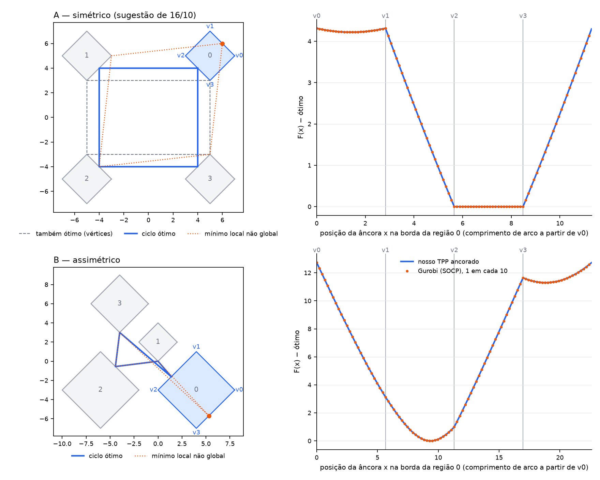

# A função de ancoragem nos quatro quadrados girados 45°

Investigação pedida na reunião de 16/10 (T27). Ela não substitui a prova; serve para
ver a função e para ter testes que não passem por coincidência.

## O que é F

No ciclo de ordem fixa por regiões convexas, fixe uma âncora `x` e resolva o TPP
com `s = t = x` pelas demais regiões, na ordem. `F(x)` é esse comprimento. O
ótimo do ciclo é o mínimo de `F` sobre a primeira região, e ele é atingido na
borda ([`convex-cycle.md`](../../algorithms/convex-cycle.md#general-boundary-reduction-and-correctness)).

O que está provado lá:

- **`F` é convexa e 2-Lipschitz no plano**, como minimização parcial de uma soma
  de normas conjuntamente convexa;
- **por isso, é convexa em cada segmento de aresta.** A busca usa isso: em cada
  segmento, as derivadas nas pontas dizem se há um ponto estacionário no
  interior, e a bissecção o encontra;
- **não se afirma convexidade ao longo da borda inteira.** A objeção da reunião
  procede: a parametrização da borda é periódica, e `F` restrita a ela pode ter
  mínimos locais que não são globais. Por isso a busca examina todos os
  segmentos e só aceita um candidato que passe no certificado global.

## A figura



À esquerda, as regiões e o ciclo ótimo; à direita, `F(x) − ótimo` com a âncora
percorrendo a borda da região 0, a partir do vértice v0. Em cada caso, `F` foi
calculada em 1000 pontos da borda de dois jeitos independentes:

- pelo nosso TPP de origem fixa;
- por um SOCP no Gurobi.

As duas diferem em no máximo 9,2e-8 (A) e 1,7e-7 (B). Nas amostras, as segundas
diferenças dentro de cada aresta nunca ficam abaixo de −3e-8, ou seja, `F` é
convexa em cada aresta até o ruído numérico.

## Caso A: a sugestão da reunião

Quatro quadrados iguais, girados 45°, nos cantos de um quadrado: centros
`(±5, ±5)`, meia diagonal 2.

- **O ótimo é 32 = 8d − 4r**, mas é atingido por uma família inteira de
  retângulos com os cantos nas arestas internas. Um deles passa pelos vértices
  internos dos quadrados (tracejado). No gráfico, `F` é constante, igual ao ótimo,
  em toda a aresta v2–v3.
- **Uma busca que testasse só os vértices passaria neste caso por coincidência.**
  É exatamente o risco que o Ernesto apontou.
- **`F` não é convexa ao longo da borda.** O meio da aresta externa, `(6, 6)`, é
  um mínimo local estrito 4,22 acima do ótimo (pontilhado).

Não dá para consertar isso só mudando os tamanhos. Com quadrados girados 45°,
todas as arestas têm uma de duas direções perpendiculares. Cada reflexão numa
delas troca as coordenadas da direção do raio, possivelmente com sinal, e a
composição das quatro reflexões de um ciclo fechado é a identidade. Por isso um
ótimo com os quatro contatos no interior de arestas vem sempre numa família de
ciclos de mesmo comprimento, como as órbitas de bilhar num retângulo.

## Caso B: contato no interior, ótimo único

Centros `(4, −3)`, `(0, 2)`, `(−6, −3)` e `(−4, 6)`, meias diagonais 4, 2, 4 e 3.

- **Os contatos nas regiões 1 e 3 são vértices**, `(0, 0)` e `(−4, 3)`. Os das
  regiões 0 e 2 são os pontos de reflexão entre eles, no interior de arestas:
  `(18/13, −21/13)` e `(−40/9, −5/9)`.
- **O ótimo é `√65 + √85 ≈ 17,2818`.** Cada termo é a distância de um vértice ao
  reflexo do outro pela aresta.
- **Testar só os vértices falha:** a melhor âncora num vértice fica 0,99 acima do
  ótimo.
- **`F` tem outro mínimo local**, na aresta v3–v0, 11,3 acima do ótimo.

## O teste

`rotated_squares()`, em
[`main-cycle_tests.cpp`](../../../packages/convex-tpp/cpp/src/main-cycle_tests.cpp),
verifica isso com aritmética exata.

- **Caso A:**
  - o ótimo do nosso solver passa no certificado independente;
  - o retângulo pelos vértices também passa no certificado de otimalidade;
  - `(6, 6)` é mínimo local de `F` ao longo da borda, mais de 4 acima do ótimo.
- **Caso B:**
  - os contatos e os comprimentos das ligações saem como os racionais exatos
    acima;
  - o certificado independente aceita a solução;
  - cada âncora num vértice fica mais de 0,99 acima do ótimo;
  - a versão em binary64 dá o mesmo valor.

Para regerar a figura:

```bash
python3 benchmarks/tpp.py build tpp-visualizer-solve
.build/fekete-upstream/venv/bin/python docs/reports/funcao-ancoragem/generate_anchor_figure.py
```

O ambiente do Fekete fornece o `gurobipy` da verificação independente. Com outro
Python, o script desenha só a curva do nosso solver.

## Limites

- São dois casos escolhidos para ilustrar, não uma prova.
- A curva tem 1000 amostras por caso. O mínimo amostrado de B fica 3e-5 acima do
  ótimo exato só por causa da resolução da amostragem.
